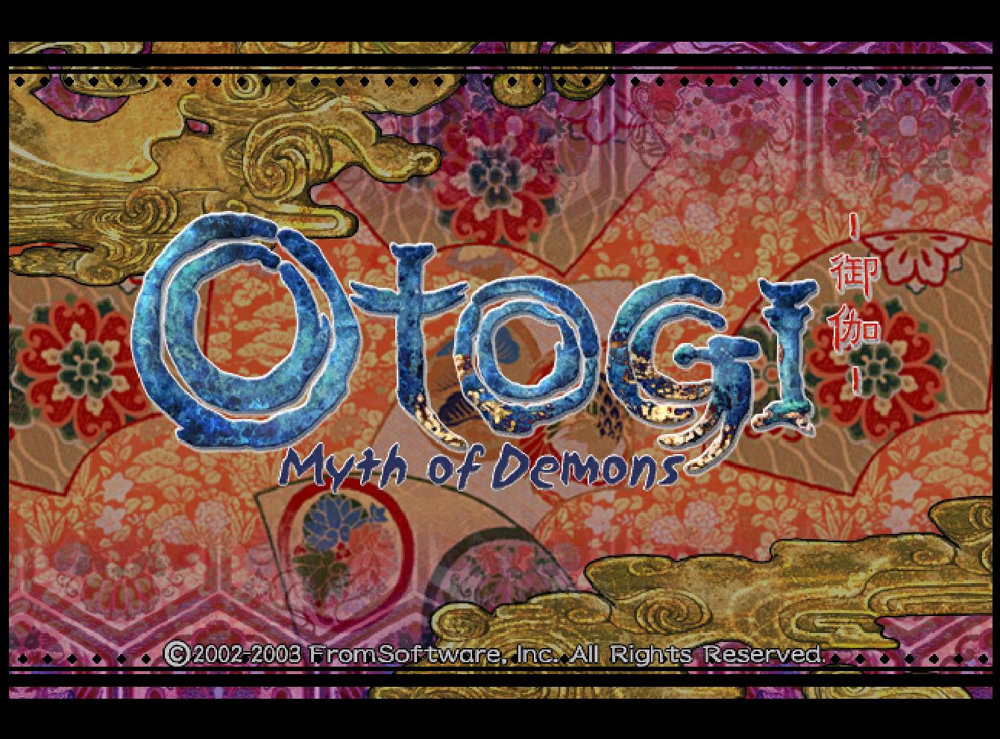
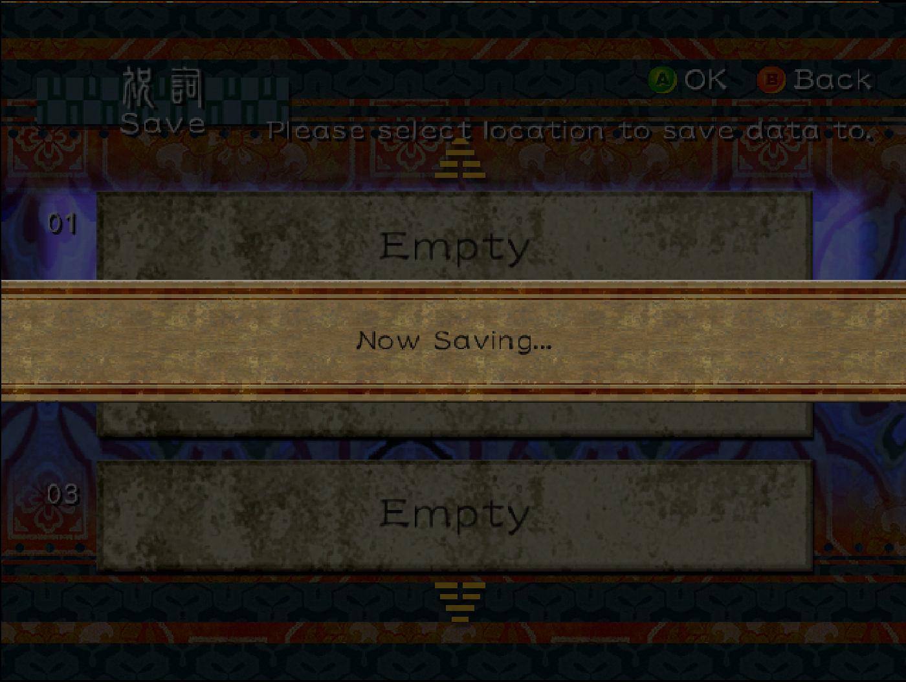
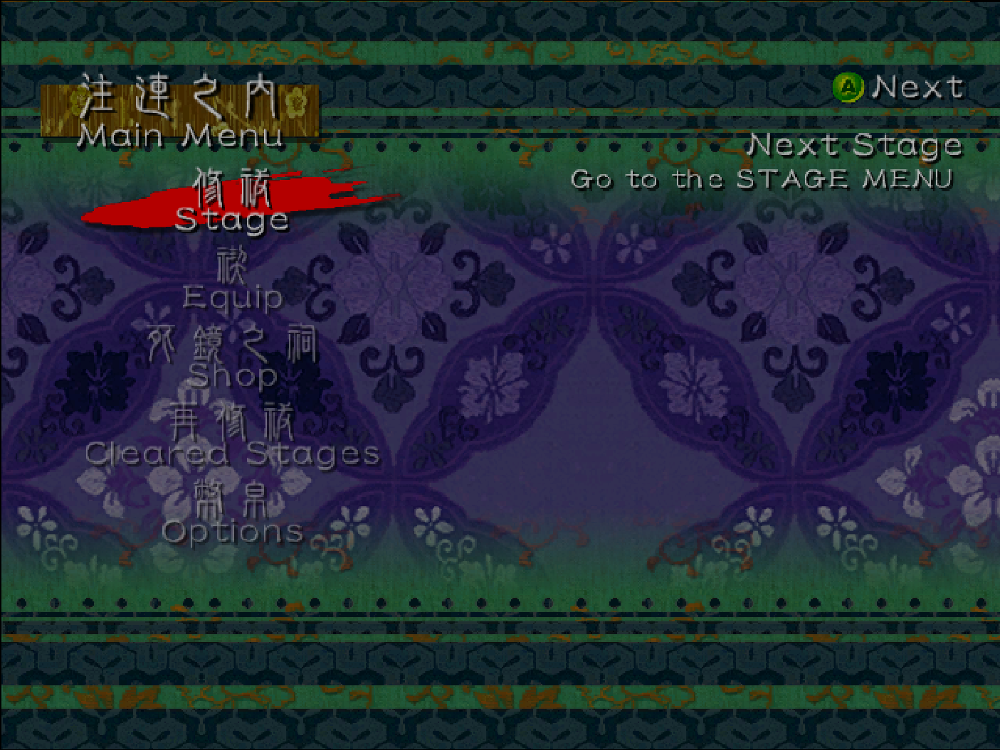
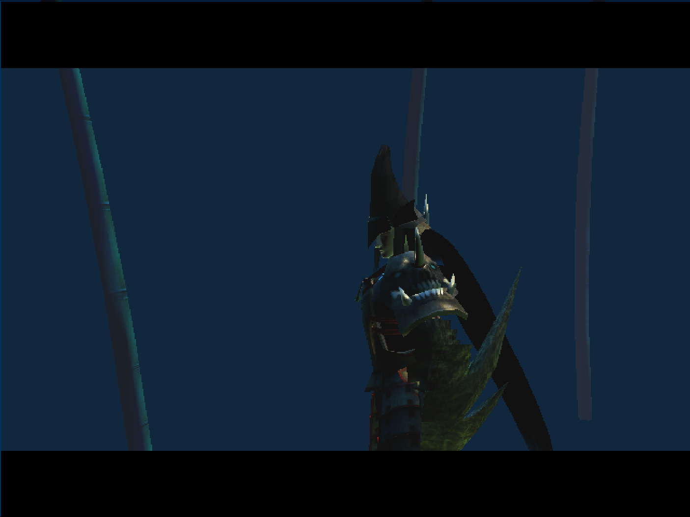
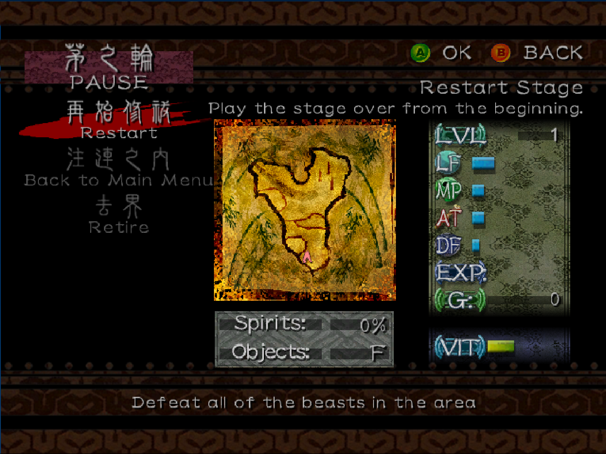
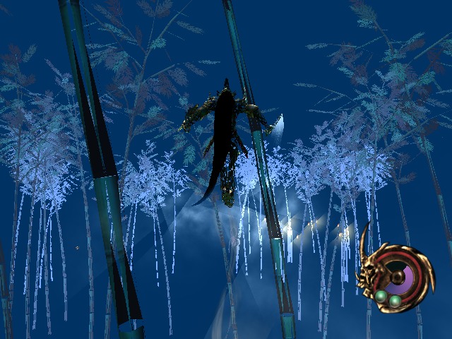

# Otogi: Myth of Demons — technical preview v0.1

[](LICENSE)
[](ROADMAP.md)


A static recompilation of the original Xbox release of *Otogi: Myth of Demons*
(FromSoftware / Sega; Japan 2002) into native executables for Linux and Windows,
built with the [xboxrecomp](https://github.com/sp00nznet/xboxrecomp) toolkit.
The game's own x86 code is translated to C and compiled natively — there is no
CPU emulator, no CPU interpreter, and no hand-written substitute for the
title's own logic.

**This is a research preview, not a playable port.** It boots the retail XBE,
runs the title's own main loop, plays the menu BGM and the attract video, and
reaches the New Game menu, save creation and loading, the main menu, the
start-game stage and the pause menu. On the stage the bamboo grove, the ground
haze, the light shafts, the HUD and the player's 3D model are drawn. The
remaining rendering gap is the title's movie — see
[`docs/KNOWN_ISSUES.md`](docs/KNOWN_ISSUES.md).

**AI-assisted.** Code, debugging, and documentation were produced with
substantial AI assistance; the maintainer reviewed and verified every change
and claim in this repository.

<p align="center">
  
</p>

## Table of contents
- [Status](#status)
- [Screens](#screens)
- [Known limitations](#known-limitations)
- [Requirements](#requirements)
- [Step by step](#step-by-step)
- [Switches](#switches)
- [Documentation](#documentation)
- [How to help](#how-to-help)
- [Contributing](#contributing)
- [Licensing](#licensing)

## Status

Status as of 2026-10-27. Runs are headless, on Linux, through the OpenGL
push-buffer back end: `RECOMP_PB_EXEC=1 RECOMP_USB=1 RECOMP_AUTOPRESS=1
./build-linux/bin/otogi1` drives the title from the logos to the start-game
stage with no pad and no window. A physical gamepad still works and is what
the earlier screenshots used.

| Component | State | Notes |
|---|---|---|
| Builds | Works | Native Linux binaries; MinGW-w64 cross-build and MSVC 2022 build for Windows verified. The MSVC build needs one source fix in the toolkit ([`docs/KNOWN_ISSUES.md`](docs/KNOWN_ISSUES.md)). `tools/smoke.sh build-linux` passes. |
| Boot | Works | Loads the XBE, reaches `[AV] SetDisplayMode`, runs the main loop, shows the logos and the title screen. No crash. |
| Kernel | Works | Threads, KEVENTs, the NV2A fence event, and asynchronous `NtReadFile` (`RECOMP_SYNC_IO=1` restores inline completion). |
| File I/O | Works | All XBE sections, assets, and the title's packed `.dev`/`.000` archives. |
| Audio | Works (BGM) | `RECOMP_AC97_READY=1`: streamed BGM with measured non-zero PCM. The DSP is a passthrough stub, so effects are not emulated. |
| Video | Works | The title's own XMV decoder plays the looping attract video. The toolkit's host video player is a POSIX stub and is not required. |
| Input | Works | Physical gamepad with `RECOMP_USB=1` (OHCI controller and emulated pad). Headless runs use `RECOMP_AUTOPRESS=1`, which taps START then A. Drives the title, New Game, save creation and loading, the main menu, the start-game stage and the pause menu. |
| Saves | Create and load work | Creating and loading a save work in the menus. Where the save file is written, and its format, are not recorded yet. |
| Rendering | Partial, on the GPU | The push-buffer executor hands batches to an OpenGL 3.3 back end (`src/nv2a/nv2a_pb_gl.c` in the toolkit): logs, the front-end menus, the intro cutscene, the stage's world and the HUD all render through it, including the title's register combiners (the pixel stage, without which menu text carried black boxes), and the frame is read back into the title's own colour surface. Remaining gap: the title's movie; the effect planes' alpha is closed in [`docs/KNOWN_ISSUES.md`](docs/KNOWN_ISSUES.md). `RECOMP_PB_GL=0` keeps the CPU rasteriser. |
| Framerate | Playable | Measured on the RX 570 / Ryzen box: 90-120 fps in the menus and the attract loop, 25-29 fps in the intro cutscene, ~40 fps on the start-game stage (12 fps before the vertex stage was decoded once, fetched selectively and run on a thread pool). |

Details and exact log lines: [`docs/BOOT_LOG.md`](docs/BOOT_LOG.md). Open blockers: [`docs/KNOWN_ISSUES.md`](docs/KNOWN_ISSUES.md).

## Screens

Screenshots from the maintainer's runs. Unless a caption says otherwise, the
switches are `RECOMP_USB=1 RECOMP_FB_WINDOW=1 RECOMP_PB_EXEC=1 RECOMP_AC97_READY=1`
with a physical gamepad.

| Create or load save | Main menu |
|:---:|:---:|
|  |  |
| **Save creation.** Loading a save also works in the maintainer's runs; no load-screen capture yet. | **Main menu.** Reached after save creation or loading. |
|  |  |
| **Start-game stage.** The player's 3D model is drawn. The stage world is not: the only scenery visible is bamboo. | **Pause menu.** Opened from the start-game stage. |



**The same stage through the OpenGL back end**, captured headlessly with
`RECOMP_FB_DUMP` (`RECOMP_PB_EXEC=1 RECOMP_USB=1 RECOMP_AUTOPRESS=1`). The
character, the HUD orb, the bamboo and the sword trail are drawn by the GPU;
the world behind them is still missing, which is the open blocker.

The open blockers behind these limits are tracked in [`docs/KNOWN_ISSUES.md`](docs/KNOWN_ISSUES.md).

## Known limitations

- **The stage world is not drawn.** The player's 3D model, the HUD and the bamboo are drawn on the start-game stage; the rest of the world is not, and shows as large flat polygons. Both rasterisers (CPU and OpenGL) show the same thing from the same decoded batches, so the fault is in what the executor builds, not in the back end. See [`docs/KNOWN_ISSUES.md`](docs/KNOWN_ISSUES.md).
- **Black screen after New Game.** Two runs on 2026-10-24 showed a black screen after the menu pan-out delay: one plain, one with `RECOMP_GUEST_LOCK=1`. Neither had `RECOMP_AC97_READY=1`. Repeated maintainer runs with `RECOMP_AC97_READY=1` did not show it. That switch is the only difference recorded, so it is a correlation, not an established cause. Stderr from a black-screen run has not been captured. See [`docs/KNOWN_ISSUES.md`](docs/KNOWN_ISSUES.md).
- **The dispatch gate is a project default, not a toolkit one.** `src/game/main.c` sets `RECOMP_DISPATCH_GATE=1` because this title's USB stack self-links its software queue on a multi-core host without it (`docs/BOOT_LOG.md`, 2026-10-26). `RECOMP_DISPATCH_GATE=0` still overrides. The gate is opt-in in the toolkit because it changes when DPCs and interrupts run for every title.
- **The OpenGL back end approximates the material path.** It samples texture stage 0 and multiplies by the interpolated vertex colour; the CPU rasteriser evaluates the title's register combiners and fog. Titles or scenes whose look depends on those draw differently, and the stage world's materials are untested against a correct reference.
- **The save file is not documented.** Creating and loading a save work. The file's location and format are not recorded yet.
- **No DSP effects.** The DSP is a passthrough stub, so the mixed output is produced but the title's audio effects are not emulated.
- **The MSVC 2022 build needs one source fix.** With the `clock_gettime` guard
  in [`docs/KNOWN_ISSUES.md`](docs/KNOWN_ISSUES.md) applied it builds, boots and
  produces audio; without it the build stops in the toolkit's input layer. The
  MinGW-w64 cross-build is the path verified without a source change.

## Requirements

- Linux x86-64, or Windows x86-64. The MinGW cross-build is verified without a source change; the MSVC 2022 build is verified with the one `clock_gettime` guard in [`docs/KNOWN_ISSUES.md`](docs/KNOWN_ISSUES.md).
- CMake 3.20+, a C11 compiler, and Ninja. The build commands below pass `-G Ninja`; drop that flag to use CMake's default generator.
- On Linux only: SDL2 and libepoxy for the video, audio and window path. Windows uses Direct3D 11 and XAudio2 from the Windows SDK instead.
- Python 3.10+ with `capstone` — `regen.sh` drives the toolkit's Python tools.
- Your own legally obtained copy of the game, as an Xbox disc image (`.iso`). Step 3 unpacks it into `game/`; its `default.xbe` is what `regen.sh` reads.
- The recompiled C in `src/game/recomp/gen/`, produced by `regen.sh`. It is generated, not tracked.

The runtime toolkit is a submodule at `xboxrecomp/`; no separate checkout is needed.

On Windows the MSVC path needs Visual Studio 2022 with the **Desktop development
with C++** workload (or the standalone **Build Tools** with the `VCTools`
workload), the Windows SDK, and CMake. A Visual Studio install does not imply
the C++ toolset — an install without it has `MSBuild` and no `cl.exe`. Check:

```powershell
& "${env:ProgramFiles(x86)}\Microsoft Visual Studio\Installer\vswhere.exe" `
    -latest -products * -require Microsoft.VisualStudio.Component.VC.Tools.x86.x64 `
    -property installationPath
```

Empty output means the workload is missing. Reserve about 8 GB free: with less,
the workload installer's pre-check fails with exit code `-2147024784`
(`0x80070070`, `ERROR_DISK_FULL`) and prints nothing to the console. The
standalone Build Tools plus the SDK are about 5 GB installed.

## Step by step

The same steps this project is developed against, in order. Commands are for a
POSIX shell — Linux, or Git Bash on Windows.

1. **Install the prerequisites.**

   | Tool | Version | Notes |
   |---|---|---|
   | Python | 3.10 or newer | runs the toolkit's Python tools |
   | capstone | 5.x | `python3 -m pip install --user capstone` |
   | CMake | 3.20 or newer | |
   | C compiler | C11 | GCC or Clang on Linux; MinGW-w64, or MSVC 19.4x from Visual Studio 2022 Build Tools, for the verified Windows build |
   | Ninja | recommended | the commands below pass `-G Ninja`; drop it to use the default generator |
   | SDL2, libepoxy | Linux only | video, audio and window path |

   ```
   $ python3 -c "import capstone; print(capstone.__version__)"
   5.0.1
   $ cmake --version | head -1
   cmake version 3.31.6
   ```

2. **Clone the repository.** The toolkit is a submodule pinned to this project's fork — no second checkout, no patch to apply.

   ```
   git clone --recursive https://github.com/sigods/otogi1
   cd otogi1
   ```

3. **Unpack your disc image** into `game/`, using the toolkit's own XDVDFS reader. Otogi's USA image carries a video partition in front of the filesystem, so tools that assume the filesystem starts at offset 0 fail; this reader probes the known partition bases.

   ```
   $ cd xboxrecomp
   $ python3 -m tools.xiso unpack "/path/to/Otogi - Myth of Demons (USA).iso" -o ../game
   $ cd ..
   ```

   You should end up with `game/default.xbe` next to `chr/`, `map/`, `sfx/`, `movie/` and the rest — 1,121 files, about 2.2 GB.

4. **Regenerate the C.**

   ```
   $ ./regen.sh
   ==> xbe_parser
   ==> disasm
   ==> func_id
   ==> abi_analysis  (never skip: silent wrong signatures otherwise)
   ==> recomp  (--split 250: prevents OOM)
   ==> done. Now: cmake --build build-linux
   ```

   This writes `src/game/recomp/gen/`, which is gitignored. It takes a while: the recompile step alone is 5–15 minutes ([`docs/PIPELINE.md`](docs/PIPELINE.md)). It is only needed once per disc. It generates C and stops — the `cmake --build` in its closing line is a suggestion, and step 5 does the configure that makes it work.

5. **Build.**

   ```
   $ cmake -S . -B build-linux -G Ninja
   $ cmake --build build-linux -j8
   ```

   The executable is `build-linux/bin/otogi1`, about 19 MB.

6. **Run it from the project root.**

   ```
   $ ./build-linux/bin/otogi1
   ```

   The binary opens `game/default.xbe` relative to the current directory. Within a few seconds the log shows the title's own display-mode call and the kernel event it builds for the GPU fence:

   ```
   [AV] SetDisplayMode mode=0x080F0D12 format=0x00000012 pitch=2560 fb=0x00404000
   [KERNEL] event 0x00106B6C built by the title: host event created (notification)
   ```

   After that it sits in the title's main loop. `Ctrl+C` ends it.

   `./tools/smoke.sh build-linux` re-checks the claims above against an existing build. It runs the title twice. The plain run captures audio, and it asserts that the title reaches `[AV] SetDisplayMode`, that it is still running when the timeout stops it (no early exit, no segmentation fault), that the audio is non-silent, and that the OHCI controllers stay off. The `RECOMP_USB=1` run asserts that the OHCI controllers come up and that there is no segmentation fault.

7. **Turn on the implemented parts.** Each is opt-in. The first line is the reference run, with a physical gamepad:

   ```
   $ RECOMP_USB=1 RECOMP_FB_WINDOW=1 RECOMP_PB_EXEC=1 RECOMP_AC97_READY=1 ./build-linux/bin/otogi1
   $ RECOMP_FB_WINDOW=1 RECOMP_AC97_READY=1 ./build-linux/bin/otogi1 # window + BGM
   $ RECOMP_PB_EXEC=1 ./build-linux/bin/otogi1 # GPU command stream
   $ RECOMP_PB_EXEC=1 RECOMP_USB=1 RECOMP_AUTOPRESS=1 ./build-linux/bin/otogi1 # headless, drives itself to the stage
   $ RECOMP_PB_EXEC=1 RECOMP_USB=1 RECOMP_AUTOPRESS=1 RECOMP_PB_GL=0 ./build-linux/bin/otogi1 # same, CPU rasteriser
   ```

   Drawing goes through the OpenGL back end by default and needs a display;
   `RECOMP_PB_GL=0` is the CPU rasteriser, about ten times slower on the same
   scene.

   On a headless box, run the window under `Xvfb`. These are the switches the README relies on; [`AGENTS.md`](AGENTS.md) § 7 lists the rest, including the diagnostic ones added during bring-up.

### Windows

Steps 1–3 are the same. `regen.sh` is a POSIX shell script, so run step 4 once from Git Bash or WSL. Then pick a toolchain:

- **MinGW-w64 cross-build — verified.** It links, and under Wine it reaches the title's display-mode call without faulting:

  ```
  $ cmake -S . -B build-win -G Ninja \
      -DCMAKE_SYSTEM_NAME=Windows \
      -DCMAKE_C_COMPILER=x86_64-w64-mingw32-gcc \
      -DCMAKE_FIND_ROOT_PATH=/usr/x86_64-w64-mingw32 \
      -DCMAKE_FIND_ROOT_PATH_MODE_PROGRAM=NEVER
  $ cmake --build build-win -j8
  ```

  The result is `build-win/bin/otogi1.exe`.- **MSVC 2022 — verified, with one source fix.** Built with Visual Studio Build
  Tools 2022 (MSVC 19.44, Windows SDK 10.0.26100) and CMake 3.31. Until the
  `clock_gettime` guard in [`docs/KNOWN_ISSUES.md`](docs/KNOWN_ISSUES.md) lands
  in the toolkit, the build stops in `xboxrecomp/src/input/keyboard.c`. The
  Windows SDK supplies Direct3D 11, DXGI, `d3dcompiler` and XAudio2, so no SDL2
  is required:

  ```
  cmake -S . -B build -G "Visual Studio 17 2022" -A x64
  cmake --build build --config Release --parallel
  ```

  The result is `build\bin\Release\otogi1.exe`, about 11 MB. CMake finds a
  non-default install through `vswhere`; when it does not,
  `-DCMAKE_GENERATOR_INSTANCE="C:\BuildTools"` names it. The build also produces
  the toolkit's four `d3d8_*` smoke executables and about a hundred warnings
  (`C4005`, `C4100`, `C4996`, `C4457`) that are not failures. `/bigobj` is
  already set for `otogi1` and is what lets the generated chunks compile — keep
  it.

Run **from the project root**, not from inside `build\`: the binary opens
`game/default.xbe` relative to the current directory.

```
./build-win/bin/otogi1.exe # MinGW cross-build
.\build\bin\Release\otogi1.exe # MSVC
```

## Switches

Every switch is an environment variable, read once at startup. The table below lists the switches these instructions use; [`AGENTS.md`](AGENTS.md) § 7 has the complete set, including the diagnostics added during bring-up.

| Variable | Effect |
|---|---|
| `RECOMP_FB_WINDOW=1` | Open the SDL framebuffer window and present frames — Linux only, off by default |
| `RECOMP_PB_EXEC=1` | Software NV2A push-buffer executor |
| `RECOMP_USB=1` | OHCI controller and emulated pad (`RECOMP_AUTOPRESS=1` sends START+A) |
| `RECOMP_AC97_READY=1` | MCPX APU and host audio output (SDL2 on Linux, XAudio2 on Windows) |
| `RECOMP_AUDIO_WAV=path` | Capture the mixed output to a WAV file |
| `RECOMP_SYNC_IO=1` | Complete `NtReadFile` inline (pre-audio-fix behaviour) |

## Documentation

- [`docs/INDEX.md`](docs/INDEX.md) — start here: which document to read, and when.
- [`docs/FAQ.md`](docs/FAQ.md) — the short answers, if you want them first.
- [`docs/ARCHITECTURE.md`](docs/ARCHITECTURE.md) — which layer owns a behaviour.
- [`docs/PIPELINE.md`](docs/PIPELINE.md) — the toolchain, step by step.
- [`docs/MSVC_2022.md`](docs/MSVC_2022.md) — the Windows MSVC 2022 build and boot record.
- [`docs/RUNNING.md`](docs/RUNNING.md) — building, running and recording the executable, in long form.
- [`docs/TITLE_OTOGI.md`](docs/TITLE_OTOGI.md) — title facts and open unknowns.
- [`docs/KNOWN_ISSUES.md`](docs/KNOWN_ISSUES.md) — what is blocking progress now.
- [`docs/BOOT_LOG.md`](docs/BOOT_LOG.md) — the append-only findings ledger.
- [`ROADMAP.md`](ROADMAP.md) — milestone status.
- [`CHANGELOG.md`](CHANGELOG.md) — what changed, and when.

## How to help

- If the black screen after New Game appears, capture stderr (`./build-linux/bin/otogi1 2>stderr.txt`) and send the lines around `[KERNEL] ordinal 175` ([`docs/KNOWN_ISSUES.md`](docs/KNOWN_ISSUES.md)).
- Name kernel ordinal 175 from the toolkit's export table under `xboxrecomp/` and record it in [`docs/BOOT_LOG.md`](docs/BOOT_LOG.md).
- Carry the `clock_gettime` guard from [`docs/KNOWN_ISSUES.md`](docs/KNOWN_ISSUES.md) into the toolkit and offer it upstream — it is the only thing between the MSVC 2022 build and a clean build.
- Run `./tools/smoke.sh` on another distribution and report any assertion that fails.
- Correct or extend a page in [`docs/`](docs/INDEX.md).
- Pick a milestone in [`ROADMAP.md`](ROADMAP.md) and open an issue naming it.

Read [`CONTRIBUTING.md`](CONTRIBUTING.md) first; it has the two rules that matter.

## Contributing

Corrections, bug reports and pull requests are welcome — read
[`CONTRIBUTING.md`](CONTRIBUTING.md) first. Two rules matter most: never commit
game data (the `repo hygiene` workflow, `.github/workflows/hygiene.yml`, fails if
`game/`, `.iso`, `.xbe`, `.xmv` or `.xps` files are tracked), and back every claim
with the evidence behind it.

Credits, the AI assistance disclosure and upstream attribution are in
[`CONTRIBUTORS.md`](CONTRIBUTORS.md). Working with an AI agent? Point it at
[`AGENTS.md`](AGENTS.md) first; it lists the pipeline gates that fail silently.

## Licensing

This project's own source is **GPL-3.0-only** — see [`LICENSE`](LICENSE). No game
data, disc image, XBE or generated recompiled source is distributed here; you
supply your own copy (see Requirements).

`xboxrecomp/` is a submodule pinned to this project's fork of the toolkit,
carrying local changes; `xboxrecomp/UPSTREAM.md` records the upstream base. Most
of the toolkit is MIT-licensed. Some files derived from xemu are
**LGPL-2.1-or-later**, not MIT: the MCPX APU sources in `xboxrecomp/src/apu/` and
the NV2A register header `xboxrecomp/src/nv2a/nv2a_regs.h`. Not every file in
those directories is xemu-derived. [`NOTICE`](NOTICE) lists them with their
copyright holders; the per-file list is in `xboxrecomp/NOTICE`, and the licence
text is in `xboxrecomp/LICENSES/LGPL-2.1.txt`.
