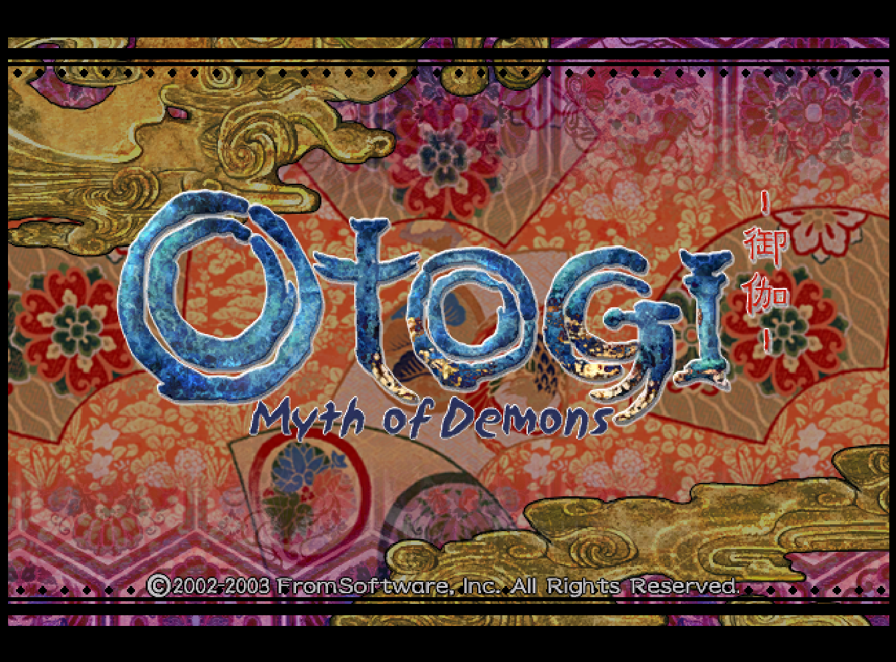
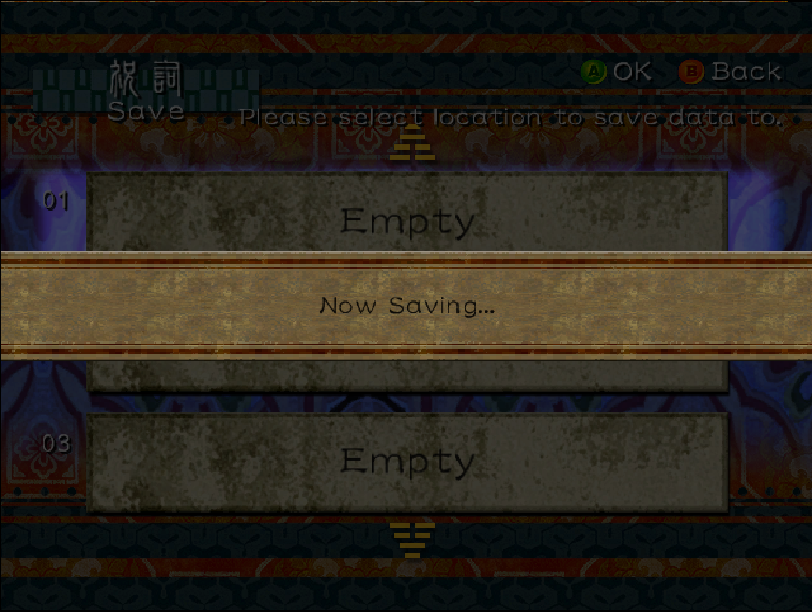
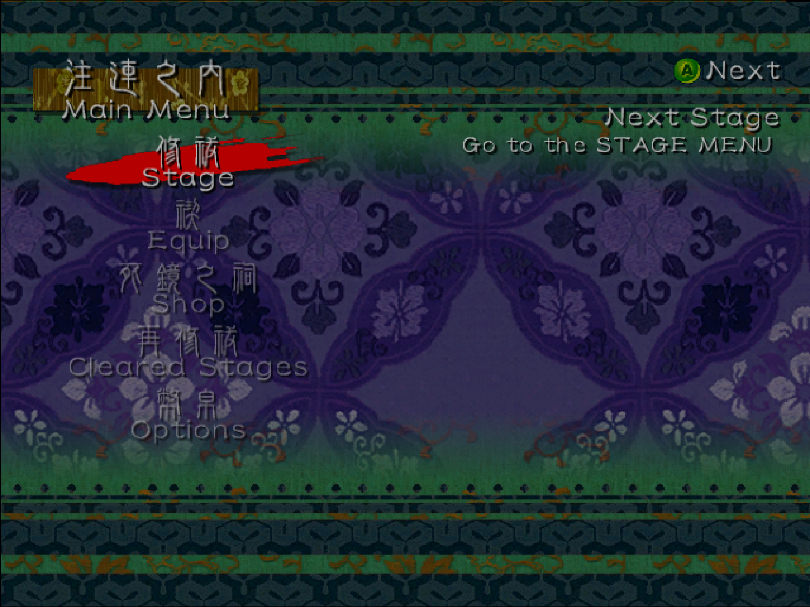
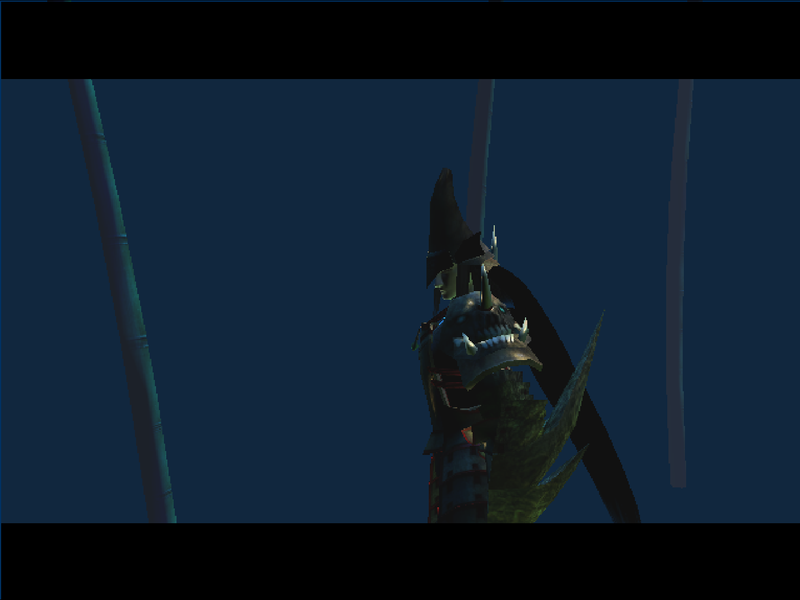
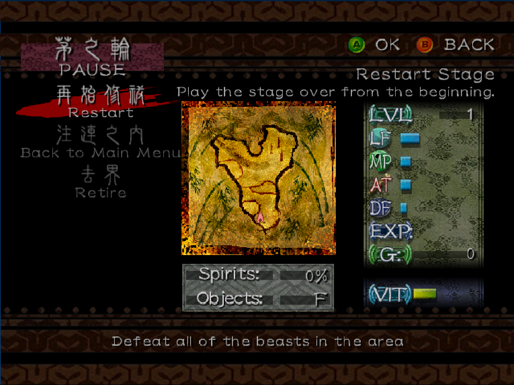
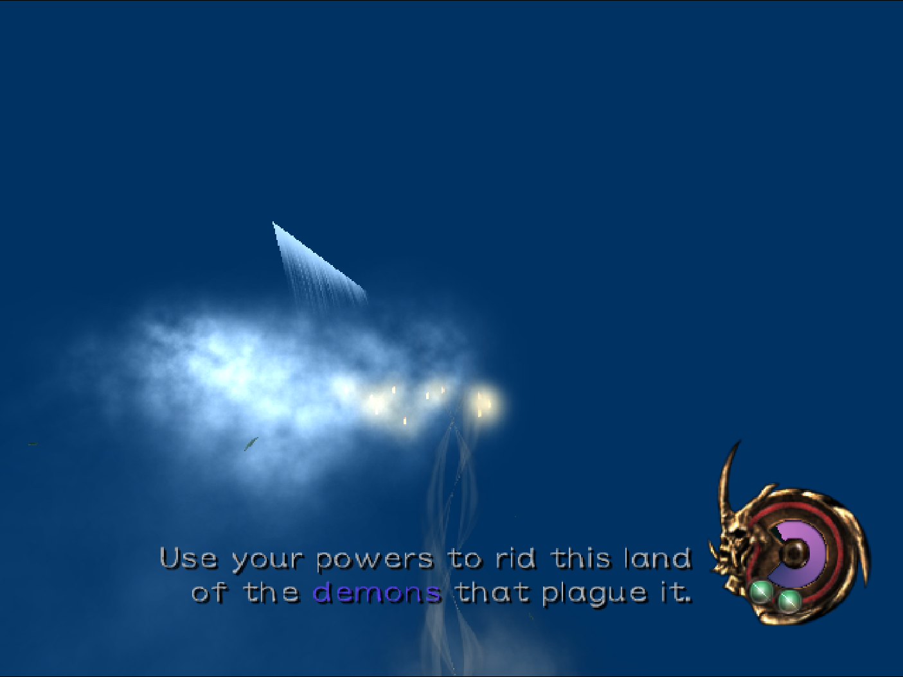

# Otogi: Myth of Demons — technical preview v0.1

[](LICENSE)
[](ROADMAP.md)


A static recompilation of the original Xbox release of *Otogi: Myth of Demons*
(FromSoftware / Sega; Japan 2002) into native executables for Linux and Windows,
built with the [xboxrecomp](https://github.com/sp00nznet/xboxrecomp) toolkit.
The game's own x86 code is translated to C and compiled natively — there is no
CPU emulator, no CPU interpreter, and no hand-written substitute for the
title's own logic.

**This is a research preview, not a playable port.** It boots the retail XBE,
runs the title's own main loop, plays the menu BGM and the attract video, and
reaches the New Game menu, save creation and loading, the main menu, the
start-game stage and the pause menu. On the stage the player's 3D model is
drawn; the stage world is not drawn yet, and only bamboo is visible.

**AI-assisted.** Code, debugging, and documentation were produced with
substantial AI assistance; the maintainer reviewed and verified every change
and claim in this repository.

<p align="center">
  
</p>

## Table of contents
- [Status](#status)
- [Screens](#screens)
- [Known limitations](#known-limitations)
- [Requirements](#requirements)
- [Step by step](#step-by-step)
- [Switches](#switches)
- [Documentation](#documentation)
- [How to help](#how-to-help)
- [Contributing](#contributing)
- [Licensing](#licensing)

## Status

Status as of 2026-10-25, from the maintainer's repeated runs. The menu and
stage flow used a physical gamepad with `RECOMP_USB=1`.

| Component | State | Notes |
|---|---|---|
| Builds | Works | Native Linux binaries; MinGW-w64 cross-build for Windows verified; MSVC 2022 documented, not yet run. `tools/smoke.sh build-linux` passes. |
| Boot | Works | Loads the XBE, reaches `[AV] SetDisplayMode`, runs the main loop, shows the logos and the title screen. No crash. |
| Kernel | Works | Threads, KEVENTs, the NV2A fence event, and asynchronous `NtReadFile` (`RECOMP_SYNC_IO=1` restores inline completion). |
| File I/O | Works | All XBE sections, assets, and the title's packed `.dev`/`.000` archives. |
| Audio | Works (BGM) | `RECOMP_AC97_READY=1`: streamed BGM with measured non-zero PCM. The DSP is a passthrough stub, so effects are not emulated. |
| Video | Works | The title's own XMV decoder plays the looping attract video. The toolkit's host video player is a POSIX stub and is not required. |
| Input | Works | Physical gamepad with `RECOMP_USB=1` (OHCI controller and emulated pad). Drives the title, New Game, save creation and loading, the main menu, the start-game stage and the pause menu. |
| Saves | Create and load work | Creating and loading a save work in the menus. Where the save file is written, and its format, are not recorded yet. |
| Rendering | Partial | 2D UI, and the player's 3D model on the start-game stage. The stage world is not drawn: only bamboo is visible. |

Details and exact log lines: [`docs/BOOT_LOG.md`](docs/BOOT_LOG.md). Open blockers: [`docs/KNOWN_ISSUES.md`](docs/KNOWN_ISSUES.md).

## Screens

Screenshots from the maintainer's runs. Unless a caption says otherwise, the
switches are `RECOMP_USB=1 RECOMP_FB_WINDOW=1 RECOMP_PB_EXEC=1 RECOMP_AC97_READY=1`
with a physical gamepad.

| Create or load save | Main menu |
|:---:|:---:|
|  |  |
| **Save creation.** Loading a save also works in the maintainer's runs; no load-screen capture yet. | **Main menu.** Reached after save creation or loading. |
|  |  |
| **Start-game stage.** The player's 3D model is drawn. The stage world is not: the only scenery visible is bamboo. | **Pause menu.** Opened from the start-game stage. |



The open blockers behind these limits are tracked in [`docs/KNOWN_ISSUES.md`](docs/KNOWN_ISSUES.md).

## Known limitations

- **The stage world is not drawn.** The player's 3D model is drawn on the start-game stage; only bamboo is visible as scenery. There is no playable level.
- **Black screen after New Game.** Two runs on 2026-10-24 showed a black screen after the menu pan-out delay: one plain, one with `RECOMP_GUEST_LOCK=1`. Neither had `RECOMP_AC97_READY=1`. Repeated maintainer runs with `RECOMP_AC97_READY=1` did not show it. That switch is the only difference recorded, so it is a correlation, not an established cause. Stderr from a black-screen run has not been captured. See [`docs/KNOWN_ISSUES.md`](docs/KNOWN_ISSUES.md).
- **No recorded cause for the input fix.** The 2026-10-22 input stall has not been seen since 2026-10-24, but no record names the change that cleared it.
- **The save file is not documented.** Creating and loading a save work. The file's location and format are not recorded yet.
- **No DSP effects.** The DSP is a passthrough stub, so the mixed output is produced but the title's audio effects are not emulated.
- **The MSVC 2022 path is untested.** The MinGW-w64 cross-build is the verified Windows path.

## Requirements

- Linux x86-64, or Windows x86-64 (the MinGW cross-build is the verified Windows path; MSVC 2022 is supported but untested).
- CMake 3.20+, a C11 compiler, and Ninja. The build commands below pass `-G Ninja`; drop that flag to use CMake's default generator.
- On Linux only: SDL2 and libepoxy for the video, audio and window path. Windows uses Direct3D 11 and XAudio2 from the Windows SDK instead.
- Python 3.10+ with `capstone` — `regen.sh` drives the toolkit's Python tools.
- Your own legally obtained copy of the game, as an Xbox disc image (`.iso`). Step 3 unpacks it into `game/`; its `default.xbe` is what `regen.sh` reads.
- The recompiled C in `src/game/recomp/gen/`, produced by `regen.sh`. It is generated, not tracked.

The runtime toolkit is a submodule at `xboxrecomp/`; no separate checkout is needed.

## Step by step

The same steps this project is developed against, in order. Commands are for a
POSIX shell — Linux, or Git Bash on Windows.

1. **Install the prerequisites.**

   | Tool | Version | Notes |
   |---|---|---|
   | Python | 3.10 or newer | runs the toolkit's Python tools |
   | capstone | 5.x | `python3 -m pip install --user capstone` |
   | CMake | 3.20 or newer | |
   | C compiler | C11 | GCC or Clang on Linux; MinGW-w64 for the verified Windows build |
   | Ninja | recommended | the commands below pass `-G Ninja`; drop it to use the default generator |
   | SDL2, libepoxy | Linux only | video, audio and window path |

   ```
   $ python3 -c "import capstone; print(capstone.__version__)"
   5.0.1
   $ cmake --version | head -1
   cmake version 3.31.6
   ```

2. **Clone the repository.** The toolkit is a submodule pinned to this project's fork — no second checkout, no patch to apply.

   ```
   git clone --recursive https://github.com/sigods/otogi1
   cd otogi1
   ```

3. **Unpack your disc image** into `game/`, using the toolkit's own XDVDFS reader. Otogi's USA image carries a video partition in front of the filesystem, so tools that assume the filesystem starts at offset 0 fail; this reader probes the known partition bases.

   ```
   $ cd xboxrecomp
   $ python3 -m tools.xiso unpack "/path/to/Otogi - Myth of Demons (USA).iso" -o ../game
   $ cd ..
   ```

   You should end up with `game/default.xbe` next to `chr/`, `map/`, `sfx/`, `movie/` and the rest — 1,121 files, about 2.2 GB.

4. **Regenerate the C.**

   ```
   $ ./regen.sh
   ==> xbe_parser
   ==> disasm
   ==> func_id
   ==> abi_analysis  (never skip: silent wrong signatures otherwise)
   ==> recomp  (--split 250: prevents OOM)
   ==> done. Now: cmake --build build-linux
   ```

   This writes `src/game/recomp/gen/`, which is gitignored. It takes a while: the recompile step alone is 5–15 minutes ([`docs/PIPELINE.md`](docs/PIPELINE.md)). It is only needed once per disc. It generates C and stops — the `cmake --build` in its closing line is a suggestion, and step 5 does the configure that makes it work.

5. **Build.**

   ```
   $ cmake -S . -B build-linux -G Ninja
   $ cmake --build build-linux -j8
   ```

   The executable is `build-linux/bin/otogi1`, about 19 MB.

6. **Run it from the project root.**

   ```
   $ ./build-linux/bin/otogi1
   ```

   The binary opens `game/default.xbe` relative to the current directory. Within a few seconds the log shows the title's own display-mode call and the kernel event it builds for the GPU fence:

   ```
   [AV] SetDisplayMode mode=0x080F0D12 format=0x00000012 pitch=2560 fb=0x00404000
   [KERNEL] event 0x00106B6C built by the title: host event created (notification)
   ```

   After that it sits in the title's main loop. `Ctrl+C` ends it.

   `./tools/smoke.sh build-linux` re-checks the claims above against an existing build. It runs the title twice. The plain run captures audio, and it asserts that the title reaches `[AV] SetDisplayMode`, that it is still running when the timeout stops it (no early exit, no segmentation fault), that the audio is non-silent, and that the OHCI controllers stay off. The `RECOMP_USB=1` run asserts that the OHCI controllers come up and that there is no segmentation fault.

7. **Turn on the implemented parts.** Each is opt-in. The first line is the reference run, with a physical gamepad:

   ```
   $ RECOMP_USB=1 RECOMP_FB_WINDOW=1 RECOMP_PB_EXEC=1 RECOMP_AC97_READY=1 ./build-linux/bin/otogi1
   $ RECOMP_FB_WINDOW=1 RECOMP_AC97_READY=1 ./build-linux/bin/otogi1 # window + BGM
   $ RECOMP_PB_EXEC=1 ./build-linux/bin/otogi1 # GPU command stream
   $ RECOMP_USB=1 RECOMP_AUTOPRESS=1 ./build-linux/bin/otogi1 # sends START+A through the emulated pad
   ```

   On a headless box, run the window under `Xvfb`. These are the switches the README relies on; [`AGENTS.md`](AGENTS.md) § 7 lists the rest, including the diagnostic ones added during bring-up.

### Windows

Steps 1–3 are the same. `regen.sh` is a POSIX shell script, so run step 4 once from Git Bash or WSL. Then pick a toolchain:

- **MinGW-w64 cross-build — verified.** It links, and under Wine it reaches the title's display-mode call without faulting:

  ```
  $ cmake -S . -B build-win -G Ninja \
      -DCMAKE_SYSTEM_NAME=Windows \
      -DCMAKE_C_COMPILER=x86_64-w64-mingw32-gcc \
      -DCMAKE_FIND_ROOT_PATH=/usr/x86_64-w64-mingw32 \
      -DCMAKE_FIND_ROOT_PATH_MODE_PROGRAM=NEVER
  $ cmake --build build-win -j8
  ```

  The result is `build-win/bin/otogi1.exe`.

- **MSVC 2022 — supported, untested.** Needs the *Desktop development with C++* workload; the Windows SDK supplies Direct3D 11, DXGI, `d3dcompiler` and XAudio2, so no SDL2 is required:

  ```
  cmake -S . -B build -G "Visual Studio 17 2022" -A x64
  cmake --build build --config Release --parallel
  ```

  The result is `build\bin\Release\otogi1.exe`.

Run from the project root, like on Linux:

```
./build-win/bin/otogi1.exe # MinGW cross-build
.\build\bin\Release\otogi1.exe # MSVC
```

## Switches

Every switch is an environment variable, read once at startup. The table below lists the switches these instructions use; [`AGENTS.md`](AGENTS.md) § 7 has the complete set, including the diagnostics added during bring-up.

| Variable | Effect |
|---|---|
| `RECOMP_FB_WINDOW=1` | Open the SDL framebuffer window and present frames — Linux only, off by default |
| `RECOMP_PB_EXEC=1` | Software NV2A push-buffer executor |
| `RECOMP_USB=1` | OHCI controller and emulated pad (`RECOMP_AUTOPRESS=1` sends START+A) |
| `RECOMP_AC97_READY=1` | MCPX APU and host audio output (SDL2 on Linux, XAudio2 on Windows) |
| `RECOMP_AUDIO_WAV=path` | Capture the mixed output to a WAV file |
| `RECOMP_SYNC_IO=1` | Complete `NtReadFile` inline (pre-audio-fix behaviour) |

## Documentation

- [`docs/INDEX.md`](docs/INDEX.md) — start here: which document to read, and when.
- [`docs/FAQ.md`](docs/FAQ.md) — the short answers, if you want them first.
- [`docs/ARCHITECTURE.md`](docs/ARCHITECTURE.md) — which layer owns a behaviour.
- [`docs/PIPELINE.md`](docs/PIPELINE.md) — the toolchain, step by step.
- [`docs/RUNNING.md`](docs/RUNNING.md) — building, running and recording the executable, in long form.
- [`docs/TITLE_OTOGI.md`](docs/TITLE_OTOGI.md) — title facts and open unknowns.
- [`docs/KNOWN_ISSUES.md`](docs/KNOWN_ISSUES.md) — what is blocking progress now.
- [`docs/BOOT_LOG.md`](docs/BOOT_LOG.md) — the append-only findings ledger.
- [`ROADMAP.md`](ROADMAP.md) — milestone status.
- [`CHANGELOG.md`](CHANGELOG.md) — what changed, and when.

## How to help

- If the black screen after New Game appears, capture stderr (`./build-linux/bin/otogi1 2>stderr.txt`) and send the lines around `[KERNEL] ordinal 175` ([`docs/KNOWN_ISSUES.md`](docs/KNOWN_ISSUES.md)).
- Name kernel ordinal 175 from the toolkit's export table under `xboxrecomp/` and record it in [`docs/BOOT_LOG.md`](docs/BOOT_LOG.md).
- Build with MSVC 2022 and report the result — that path is supported but has never been run.
- Run `./tools/smoke.sh` on another distribution and report any assertion that fails.
- Correct or extend a page in [`docs/`](docs/INDEX.md).
- Pick a milestone in [`ROADMAP.md`](ROADMAP.md) and open an issue naming it.

Read [`CONTRIBUTING.md`](CONTRIBUTING.md) first; it has the two rules that matter.

## Contributing

Corrections, bug reports and pull requests are welcome — read
[`CONTRIBUTING.md`](CONTRIBUTING.md) first. Two rules matter most: never commit
game data (the `repo hygiene` workflow, `.github/workflows/hygiene.yml`, fails if
`game/`, `.iso`, `.xbe`, `.xmv` or `.xps` files are tracked), and back every claim
with the evidence behind it.

Credits, the AI assistance disclosure and upstream attribution are in
[`CONTRIBUTORS.md`](CONTRIBUTORS.md). Working with an AI agent? Point it at
[`AGENTS.md`](AGENTS.md) first; it lists the pipeline gates that fail silently.

## Licensing

This project's own source is **GPL-3.0-only** — see [`LICENSE`](LICENSE). No game
data, disc image, XBE or generated recompiled source is distributed here; you
supply your own copy (see Requirements).

`xboxrecomp/` is a submodule pinned to this project's fork of the toolkit,
carrying local changes; `xboxrecomp/UPSTREAM.md` records the upstream base. Most
of the toolkit is MIT-licensed. Some files derived from xemu are
**LGPL-2.1-or-later**, not MIT: the MCPX APU sources in `xboxrecomp/src/apu/` and
the NV2A register header `xboxrecomp/src/nv2a/nv2a_regs.h`. Not every file in
those directories is xemu-derived. [`NOTICE`](NOTICE) lists them with their
copyright holders; the per-file list is in `xboxrecomp/NOTICE`, and the licence
text is in `xboxrecomp/LICENSES/LGPL-2.1.txt`.
